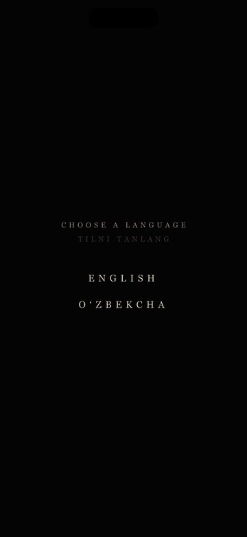
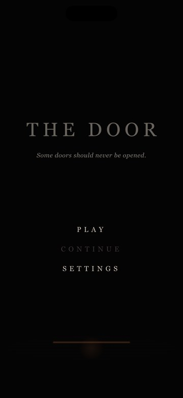
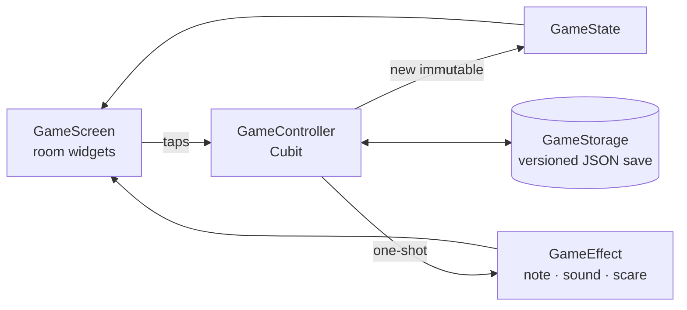

<div align="center">


# The Door

***Some doors should never be opened.***

A small psychological-horror puzzle game for iOS and Android, built with Flutter.
Eleven rooms, one story, two endings, in English and Uzbek.


</div>

<p align="center">
  
  &nbsp;&nbsp;
  
</p>

---

## About

There is a house with a door that must never be opened from the inside. Each room has one
rule, written on a note. Follow the rules, solve the room, find the key, and move on to
the next door. Break a rule and something notices.

The game uses no game engine and no image files: every room, object and scare is drawn
with `CustomPainter`, and every sound is synthesised by a script.

## Features

- 🚪 **Eleven rooms, eleven rules:** a dark room, a mirror at midnight, candles, a radio,
  a music box, talking portraits, servant bells, a dinner table, and more.
- 📖 **One story told in fragments.** It comes through intro cards, notes, whispers, and
  objects that only make sense rooms later.
- 🔀 **Two endings**, decided in the final room.
- 👁️ **Hints.** The eye icon whispers the next step for where you are, and glows red after
  45 s without progress.
- 💾 **Mid-room saving.** Inventory, clues, candles, plates and bell rounds are saved on
  every change, so CONTINUE resumes where you left off. Saves are versioned, so an outdated
  save restarts its room instead of loading wrong data.
- 🌐 **English and Uzbek**, chosen on first launch and switchable in Settings.
- 🔊 **Atmosphere.** Synthesised ambience and effects, haptics, and jump scares that never
  kill you.

## Getting started

Requirements: Flutter 3.41+ (Dart 3.11+), and Xcode or the Android SDK.

```bash
git clone https://github.com/SharifMuminov/the-door.git
cd the-door
flutter pub get
flutter run
flutter test
```

Build an installable Android package:

```bash
flutter build apk --release     # build/app/outputs/flutter-apk/app-release.apk
```

## Rooms

| # | Room | The rule |
|---|------|----------|
| 01 | THE RULE | Do not turn on the light |
| 02 | DON'T LOOK | At 12, don't look in the mirror |
| 03 | THE CANDLES | Light them in the order they left |
| 04 | HIDE | When the light goes out, hide |
| 05 | DON'T ANSWER | If it calls for you, don't answer |
| 06 | THE LULLABY | When the music stops, don't move |
| 07 | THE PORTRAITS | The dead do not lie. One of them is not dead |
| 08 | THE BELLS | When the bells ring, ring them back |
| 09 | THE DINNER | Set a place for everyone in this house. Never for the guest |
| 10 | THE HANDWRITING | Count the marks |
| 11 | THE KNOCK | When someone knocks, don't open |

<details>
<summary><b>📜 The story (spoilers)</b></summary>

<br/>

There is a house with a door that must never be opened from the inside: something waits
behind it, and it cannot open the door by itself. It took ELIAS (1948), MARTA (1961) and
ANNA (1979), always on the night of 9 April at 3:17. Anna's baby survived. The player is
that child, grown up, and has been here before: forty-one times. Every rule on every note
is in the player's own handwriting.

The story is told in small pieces: one line on each room's intro card, the notes, the
whispers, and objects that only make sense later. The scratches on the table in Room 01
are counted in Room 10. The calendar's *April 1979*, the cradle's *9 APRIL 1979 · 3:17*
and the keypad's `317` are the same night.

</details>

<details>
<summary><b>🗝️ Walkthrough (spoilers)</b></summary>

<br/>

| Room | Solution |
|------|----------|
| 01 — THE RULE | Drawer → torn page `3-1-7` → door keypad `317` |
| 02 — DON'T LOOK | Look in the mirror *before* midnight: it shows the crooked painting → painting → key. After midnight the painting gives the key anyway. |
| 03 — THE CANDLES | The back of the photo reads ELIAS 1948, MARTA 1961, ANNA 1979 → light the candles in that order (the names are carved in the wax). The wrong order blows them all out. |
| 04 — HIDE | When the bulb flickers, get into the wardrobe. Something walks past and leaves a key on the floor. Caught in the open = a scare, no death. |
| 05 — DON'T ANSWER | Turn the radio dial: the numbers station says `4-0-9` (the calendar circles April 9). The caller asks you to answer: stay silent. Keypad `409`. |
| 06 — THE LULLABY | The music box starts after the note (or wind it). While it plays, tap the doll three times to open its hands → key. When it stops, touch nothing: the doll sees you and closes its hands again. Each silence it comes closer. |
| 07 — THE PORTRAITS | Ask each portrait. Elias: *Marta is not Marta*. Marta: *behind Anna*. Anna: *behind Elias*. Only one liar fits: Marta (she also stares and blinks). Look behind Elias → key. Behind Marta: a scare. |
| 08 — THE BELLS | Repeat the tune: 3, then 4, then 5 bells (DINING, NURSERY, STUDY, GALLERY, NURSERY). A wrong bell or no answer brings footsteps, then the tune again. |
| 09 — THE DINNER | Plates for Elias, Marta, Anna, *and the card with no name* (you). A plate for the GUEST: it sits down, and every plate breaks. |
| 10 — THE HANDWRITING | 20 on the wall + 15 on the desk + 6 under the loose floorboard = `41` → diary lock → the diary (your handwriting) and the key. The inkwell: your own handwriting. |
| 11 — THE KNOCK | Wait for the knock → phone → lift the small clock → key. **Open** = bad ending. Read the **window** first → **Lock it** = good ending. |

</details>

## Architecture



- **The rules live in `GameController`.** The UI only reports taps. The controller
  updates the immutable `GameState` and sends one-shot `GameEffect`s, such as showing a
  note, playing a sound or scaring the player, which `GameScreen` plays.
- **Rooms are data.** Each `Level` has a `RoomKind` that selects its rules, so rooms can
  be reordered or inserted without renumbering. Object positions are floor-anchored
  "stage units" (`ObjectPlacement`), so a room keeps its proportions on any screen.
- **Text** is written as `LText('English', 'O‘zbekcha')` next to the data that uses it,
  and resolved in widgets with `context.tr(...)`.

## Project structure

```
lib/
├── main.dart                  portrait lock, immersive mode, service init
├── app/                       app widget, theme, settings cubit (+ context.tr)
├── core/
│   ├── constants/             colours, storage keys, timings
│   ├── l10n/                  LText (one text, every language), UI strings
│   └── utils/                 AudioManager, Haptics, GameStorage, FadeRoute
└── game/
    ├── data/game_data.dart    all rooms, clues, items and lines (both languages)
    ├── models/                GameObject, Clue, Puzzle, Level (+ RoomKind), InventoryItem
    ├── logic/                 GameController (Cubit), GameState (+ JSON), GameEffect, hints
    ├── screens/               splash (language), main menu, game, ending
    └── widgets/               room, objects, door, dialogs, horror & hide overlays
        └── painters/          every object is drawn with CustomPainter
tool/
├── app_icon/                  icon generator (drawn in code)
└── sounds/                    sound generator for rooms 06–10 (pure Python)
```

## Tooling

| Task | Command |
|------|---------|
| Regenerate the app icon | `flutter test tool/app_icon/app_icon_test.dart` |
| Regenerate sounds for rooms 06–10 | `python3 tool/sounds/synth_sounds.py` |

The icon tool writes every iOS size (without alpha, as the App Store requires), the
Android legacy and adaptive icons, and `tool/app_icon/app_icon_1024.png` for store pages.

All sounds are placeholders synthesised from scratch (see
[assets/README.md](assets/README.md)), and the game runs even with `assets/sounds/`
empty. To replace any sound, keep the same file name.
